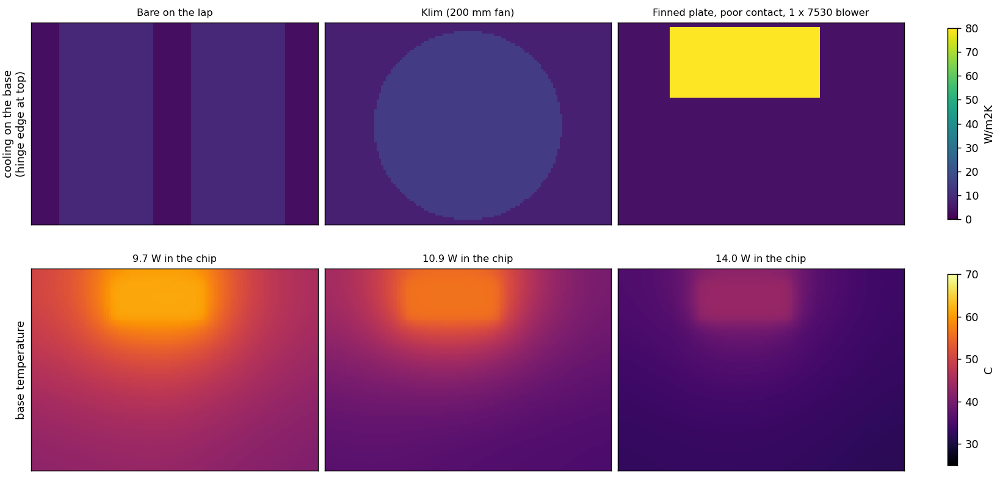

# Cooling study

14 November 2026. Where the fans go, how big they are and what kind of cooling the Lap
Dock uses, from a thermal model calibrated to published measurements of the 13-inch M5
MacBook Air. Full result tables: [cooling-study-tables.md](cooling-study-tables.md).
Code: `sim/`.

## Conclusions

1. **The thermal pad inside the Air is the main lever.** A stock Air's chip sits near
   100 °C while the case above it is about 44 °C, so the bottleneck is inside the
   laptop. No tray gains more than about 20% on a stock Air. With the pad, the right
   tray gains about 45–50% over a padded Air on a bare lap, and about 80% over a stock
   Air on a bare lap.
2. **Thin flat (axial) fans are the wrong fan.** They make about 15 Pa of pressure. Fed
   through channels under a lap and exhausting through a 5 mm gap, they deliver 5–20% of
   their rated airflow, whatever their size, number or position. The result is no better
   than the Klim.
3. **A finned contact plate with one small blower is the best arrangement.** Fins give a
   small airflow a large surface. It wins even when contact with the Air is poor.
4. **Blowing along the bare base is the fallback.** It is about half as effective as the
   finned plate but needs no contact at all.
5. **Fan position along the back barely matters; the plate's position does.** The plate
   goes under the hinge-side third, centre to left of centre.
6. **A padded Air used without the tray gets too hot to hold.** The model gives about
   60 °C on the base at full load on a bare lap. The touch limit for long contact is
   48 °C.

**Decision, 14 November 2026:** the owner is leaving his Air unmodified, so the tray is
built with conclusion 4's arrangement (blower, air along the bare base) and the finned
plate is an optional upgrade. On a stock Air the model gives 7.7 W bare on a lap, 8.4 W
on the Klim, 8.8 W on the new tray and 9.2 W with the finned plate.

## Results at 25 °C, Air with the thermal pad fitted

| Arrangement | Sustained chip power | Hottest base | Air moved | Noise |
|---|---|---|---|---|
| Bare on the lap | 9.7 W | 61 °C | - | - |
| Klim (200 mm fan) | 10.9 W | 56 °C | - | about 23 dBA |
| Best thin-fan layout (one 120 mm under the hot spot) | 11.3 W | 55 °C | 13 m³/h | 22 dBA |
| Blower, 4 mm channel along the bare base | 12.0 W | 52 °C | 9 m³/h | 28 dBA |
| **Blower through a finned plate, poor contact** | **13.8 W** | **45 °C** | 7 m³/h | 28 dBA |
| Blower through a finned plate, fair contact | 14.6 W | 41 °C | 7 m³/h | 28 dBA |
| Ceiling (hot zone held at air temperature) | 18.2 W | 26 °C | - | - |

The blower rows use one 75 mm blower at 70% speed. For comparison, a stock Air reaches
7.7 W bare on the lap, 8.4 W on the Klim and 9.2 W on the finned plate.

At 35 °C everything drops by about 2 W; the finned plate with the pad still holds about
12 W, against 8.5 W for a padded Air on a bare lap.

## How the model works

- The Air's bottom case and top case are two aluminium plates on a 2.5 mm grid, joined
  at the rim. A lumped chip and board shield sit between them, connected to the bottom
  case across a 1–1.5 mm air gap (or the thermal pad) and to the top case through the
  board.
- Each cooling arrangement is a map of heat-transfer coefficient over the base. For
  fans, the airflow is where the fan's pressure curve meets the resistance of the intake
  and the passage; the coefficient follows from that flow using standard correlations.
- The answer reported is the chip power that holds the chip at 100 °C.

## Calibration and checks

Fitted to Notebookcheck's nine-point top and bottom temperature maps of the 13-inch M5
Air at full load (21.5 °C room, about 8.5 W sustained in the chip, about 24 W at the
wall). The fit is within 1.7 K RMS over 18 points.

Not fitted, used as checks:

| Published result | Model |
|---|---|
| Fan stand under a stock M4 Air: up to +14% benchmark score | +14% chip power |
| Thermal pad alone on an M2 Air: about +12% Cinebench score | +24% chip power, consistent if score rises roughly with the square root of power |
| Fan stand plus pads on an M4 Air: up to +23% score | +56% chip power |

## What this does not tell us

- **Absolute numbers.** Treat them as good to about ±20%. The ranking is more robust
  than the values.
- **Intake area on a lap.** I assumed thighs and clothing leave 12 cm² of the underside
  channels open. This single guess sets the airflow of every arrangement. On a bench the
  flow nearly doubles.
- **Contact quality.** "Poor" means 0.15 mm of trapped air under the plate. Worse is
  possible with only the laptop's weight pressing down.
- **Apple's own limits.** The model stops at a 100 °C chip. macOS may also throttle on
  case temperature, in which case a bare lap is worse than shown and the tray's gain is
  larger.
- **Noise.** Figures are datasheet values scaled by speed, not measurements in the tray.
- **Fan curves** are straight lines between the datasheet's two end points.
- **The exact chip position** left to right. The published maps give "centre to left of
  centre"; the repair shop's photograph of the open laptop will settle it.

Phase 1's prototype exists to replace these with measurements.

## Lap heat

Sheynkin's studies found scrotal temperature rose 2.3–2.8 °C in an hour of laptop use
with legs together, that a plain lap pad did not prevent it, and that sitting with legs
apart roughly halved it. Moving air across the lap is worth having, but the published
guide must not claim the pad protects on its own.

## Sources

- Notebookcheck, MacBook Air 13 M5 review (temperature maps, power): https://www.notebookcheck.net/Insane-performance-and-efficiency-without-fans-Apple-MacBook-Air-13-M5-Entry-Review.1242707.0.html
- iFixit, M2 MacBook Air teardown (no heat spreader, thin shield): https://www.ifixit.com/News/62674/m2-macbook-air-teardown-apple-forgot-the-heatsink
- 9to5Mac, M2 Air thermal pad thickness test: https://9to5mac.com/2022/08/11/m2-air-thermal-pad-mod/
- Tom's Hardware, modded M3 Air with cooling dock: https://www.tomshardware.com/laptops/macbooks/modded-m3-macbook-air-outperforms-the-more-expensive-m3-macbook-pro-supercharged-cooling-solution-delivers-big-performance
- Geeky Gadgets, M4 Air fan stand and pads: https://www.geeky-gadgets.com/m4-macbook-air-thermal-mod/
- Zuckerman and Lior, jet impingement heat transfer: https://www.engineering.upenn.edu/~lior/lior%20papers/Jet%20Impingement%20Heat%20Transfer%20Ch06-P020039.pdf
- Mechatronics B5015 blower datasheet: https://www.mechatronics.com/pdf/B5015.pdf
- Same Sky CBM-7530B blower: https://datasheet.eeworld.com.cn/view/19086980.html
- Arctic P14 Slim specification: https://www.arctic.de/media/34/82/c3/1690274860/Spec_Sheet_P14_Slim_PWM_PST_EN.pdf
- Sheynkin et al. 2011, scrotal hyperthermia in laptop users: https://researchconnect.stonybrook.edu/en/publications/protection-from-scrotal-hyperthermia-in-laptop-computer-users/
- UL brief on IEC 62368-1 touch temperatures: https://japan.ul.com/wp-content/uploads/sites/27/2014/06/1_techbrief_touchtemp.pdf
